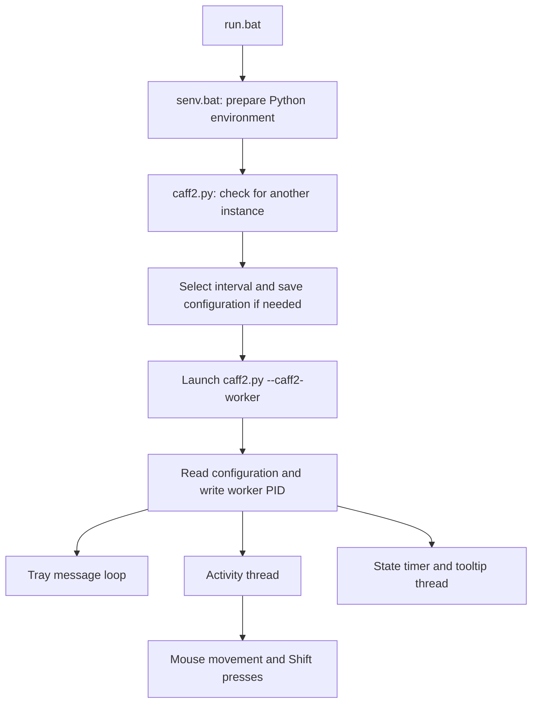

# Processes, activity cycles, and state

[Documentation home](../README.md) · Explanation

Caff2 separates a short-lived launcher from the background worker that owns
the tray icon. This lets the launching terminal return while the application
continues in the signed-in Windows desktop session.

## Launch and lifetime

`run.bat` prepares the environment and sets the working directory to the
repository root. The launcher checks for an existing worker before changing
configuration. It chooses an interval from arguments, the INI file, or an
interactive prompt, in that order. The worker reads the INI file again;
the interval is not passed directly to it on the command line.

The child uses the same Python executable as the launcher. Windows process
flags, startup information, and console-window API calls hide the worker's
console, and its standard streams are redirected to the null device.
The initial batch/setup window can still be visible.

The launcher exits after creating the worker. Its success status does not
confirm that the tray and background threads initialized successfully.
The installed `infi.systray` library runs its message loop in another thread;
the two Caff2 activity/tooltip threads are daemon threads. Caff2's own **Exit**
callback sets a stop flag, removes the lock, then terminates the worker.

## Two different clocks

The **activity interval** is the configured number of minutes between input
cycles. The first cycle waits a full interval after the background task starts.
At each cycle the worker checks its state, sends input if running, or records
a skipped cycle if paused. The wait loop checks for stopping every half second.

A **state duration** is the number of minutes chosen from the Run or Pause
menu. A separate thread checks its deadline roughly once a second:

| State | Input cycles | At deadline |
|---|---|---|
| Running indefinitely | Enabled | No deadline |
| Running for a duration | Enabled | Pause indefinitely |
| Paused indefinitely | Skipped | No deadline |
| Paused for a duration | Skipped | Run indefinitely |

Selecting a new state replaces the previous deadline. Timed transitions do not
restore a previous timed state, and they do not restart the activity clock.
The explicit **Resume** item additionally requests an action after about half
a second when resuming from a pause. Automatic resume and **Run** selections
wait for the next regular cycle.

Consequently, a short timed run may finish without any input if no activity
cycle falls inside it. Timers use the local wall clock, so clock adjustments,
suspension, and scheduling delays can affect their timing. None of this state
is persisted: each new worker starts running indefinitely.

## Instance detection and its limits

The worker writes its PID to `caff2.lock` beside the application. A subsequent
launcher checks that PID and also searches Python command lines for
`caff2.py` with `--caff2-worker`. Invalid or apparently stale locks are removed
by the detection code.

This is a best-effort check, not an atomic system-wide mutex. The lock's PID
check recognizes a process by its Python name rather than verifying its full
command line. PID reuse can cause a false positive, simultaneous launches can
race, and the process scan may detect a worker from another copy of Caff2.
Use one launch at a time and inspect the process before removing a lock.

## Persistence and diagnostics

Configuration and action logs are relative to the working directory; lock and
debug files are relative to `caff2.py`. `run.bat` makes those directories agree.
Starting Python directly elsewhere can split them. Generated tray icons go in
the Windows temporary directory. Logs append without rotation.

The [file reference](../reference/files-and-internals.md) maps these artifacts
and the source functions. The [tray reference](../reference/tray.md) lists
the exact menu choices and icon states.
